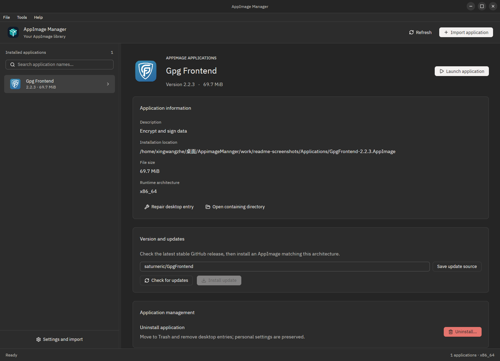
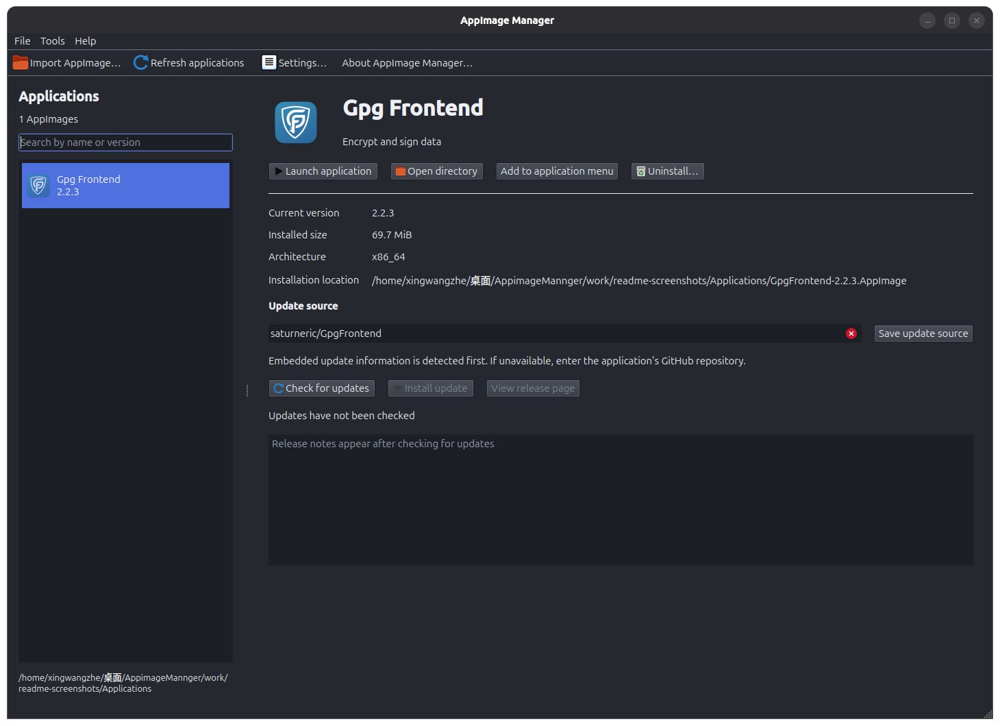
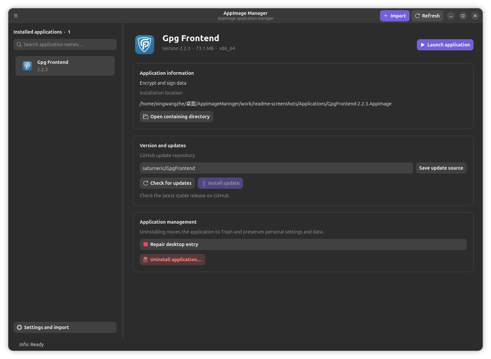

# Menedżer AppImage

[](https://github.com/xingwangzhe/AppimageMannger/actions/workflows/linux.yml)

[English](README.md) · [简体中文](README.zh-CN.md) · [繁體中文](README.zh-TW.md) · [日本語](README.ja.md) · [한국어](README.ko.md) · [Deutsch](README.de.md) · [Français](README.fr.md) · [Español](README.es.md) · [Português (Brasil)](README.pt-BR.md) · [Русский](README.ru.md) · [Italiano](README.it.md) · [Nederlands](README.nl.md) · [Polski](README.pl.md) · [Türkçe](README.tr.md) · [Українська](README.uk.md) · [Tiếng Việt](README.vi.md) · [Bahasa Indonesia](README.id.md) · [ไทย](README.th.md) · [العربية](README.ar.md) · [हिन्दी](README.hi.md) · [বাংলা](README.bn.md) · [فارسی](README.fa.md) · [עברית](README.he.md) · [Svenska](README.sv.md) · [Čeština](README.cs.md) · [Română](README.ro.md)

Menedżer AppImage to natywny menedżer aplikacji AppImage dla Linuksa. Wybierz aplikację z listy po lewej, aby po prawej zobaczyć ikonę, wersję, architekturę, rozmiar i ścieżkę instalacji. Importowanie kopiuje plik do zarządzanego katalogu i zachowuje pierwotnie pobrany plik.

## Trzy natywne interfejsy

Wszystkie zrzuty pokazują angielski interfejs wersji 1.0.1. Każdy przetłumaczony README używa tych samych trzech obrazów.

### Ely / GPUI



### Qt 6 Widgets



### GNOME / GTK 4 / libadwaita



## Funkcje

- Import zastępuje starsze wersje. Oryginalny plik pozostaje, a poprzednie instalacje można przywrócić z kosza.
- Ikony aplikacji i integracja AppImage z „Otwórz za pomocą”. `--repair-registration` naprawia rejestrację.
- Bezpośrednie anonimowe pobieranie Releases przez HTTPS, kontrola architektury i SHA-256, rzeczywisty postęp, procent i rozmiar przesłanych danych. Bez `gh` i tokena.
- Przeciągane podziały i zapis ustawień w Ely/GPUI, Qt 6 Widgets oraz GNOME/GTK 4; nazwy wyświetlane w 26 językach.
- Odczyt metadanych i ikon bez uruchamiania ani montowania AppImage.

## Instalacja i uruchomienie

Pobierz z Releases pakiet dla swojego procesora i wybierz jedną z poniższych metod. W wersji przenośnej zastąp AppimageMannger.AppImage rzeczywistą nazwą pliku. Udostępniane są pakiety Arch; instrukcja nie zakłada oficjalnego wpisu w AUR.

```sh
# Debian / Ubuntu
sudo apt install ./appimage-mannger*.deb
# Fedora / RPM
sudo dnf install ./appimage-mannger*.rpm
# Arch Linux
sudo pacman -U ./appimage-mannger*.pkg.tar.zst
# AppImage
chmod +x ./AppimageMannger.AppImage
./AppimageMannger.AppImage
```

## Trwałe ustawienia

Domyślny katalog to ~/Applications. Zmienisz go w ustawieniach; istniejące aplikacje nie zostaną automatycznie przeniesione. Dostępne są rzeczywiste interfejsy GPUI/Ely, Qt 6 Widgets oraz GNOME/GTK 4/libadwaita. Zmiana zapisuje preferencje i uruchamia menedżer ponownie. Motyw, katalog, język, wybrana aplikacja i stan okna są zachowywane. Ustawienia → Język pozwalają wybrać jeden z 26 języków. Poziomy diagnostyczne Error, Info i Warning celowo pozostają angielskie.

## Aktualizacje i usuwanie

Przed sprawdzeniem aktualizacji zweryfikuj repozytorium GitHub aplikacji. Obsługiwane metadane .upd_info są odczytywane automatycznie; można też podać owner/repository. Wyszukaj stabilne wydanie i zainstaluj odpowiedni AppImage. Sprawdzane są rozmiar i format, a SHA-256 jest weryfikowane, gdy opublikowano skrót. Wymiana jest atomowa i zachowuje kopię poprzedniej wersji. Nieudana aktualizacja pozostawia zainstalowaną aplikację.

Odinstalowanie przenosi aplikację i wpisy pulpitu do kosza, skąd można je przywrócić. Osobista konfiguracja pozostaje zachowana.


## Rozwój

[BUILD-AND-RELEASE](docs/BUILD-AND-RELEASE.md) · [ARCHITECTURE](docs/ARCHITECTURE.md) · [i18n](docs/i18n/COVERAGE.md) · [1.0.1](docs/RELEASE-1.0.1.md) · [THIRD-PARTY-NOTICES](docs/THIRD-PARTY-NOTICES.md)

```sh
bun run scripts/check-i18n.ts
cargo fmt --all --check
cargo clippy --all-targets --locked -- -D warnings
cargo test --release --locked
cargo build --release --locked
bun run scripts/package.ts --formats deb
```

## Licencja i źródła

Obowiązuje AGPL-3.0-only. Możesz używać, modyfikować i rozpowszechniać projekt zgodnie z licencją. Dystrybucja i zmienione usługi sieciowe wymagają udostępnienia odpowiednich źródeł. Pełne warunki zawiera LICENSE.

[Kod i wydania](https://github.com/xingwangzhe/AppimageMannger)

AGPL-3.0-only © 2026 xingwangzhe · xingwangzhe@outlook.com · [LICENSE](LICENSE)
