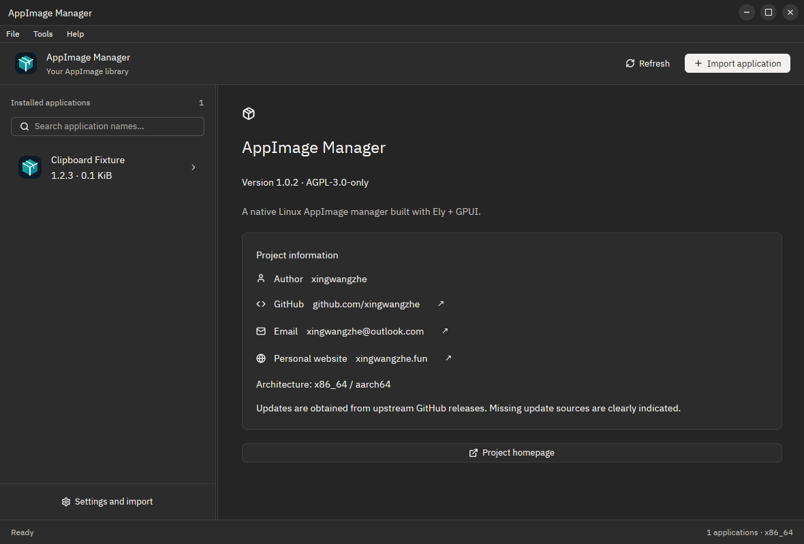

# 1.0.2 release record

## Changes

- Library scans read and parse the desktop directory once per scan, then reuse that snapshot for every AppImage. Launch command quoting, field-code restrictions, fresh scans after edits, symlink rejection and metadata precedence remain covered by regression tests. Case-insensitive sort keys and stable application IDs are computed once where reused.
- Translation lookup retains the resolved active locale, indexes reverse English lookups and uses a regex set to identify dynamic-message candidates. The original lookup algorithm is retained in tests to compare all catalog keys, English values and dynamic messages across 26 languages. Ely Browse/Choose overrides borrow the bundled catalogs instead of leaking new allocations.
- GPUI uses Ely selectable text for content, details, statuses, list entries and About fields. Native Qt labels support mouse and keyboard selection; GTK applies selection to labels in the main view and later dialogs. Action captions provide copy menus. Application icons provide image copy menus; GPUI rasterizes safe SVGs to bounded PNG and uses native clipboard owners because its current Linux backend publishes only text.
- About includes author xingwangzhe, GitHub profile, email and personal website in all three frontends. Icons accompany concise translated labels; names, addresses and URLs remain stable. Contact links are separate from text selection.
- Five new shared message IDs cover text/image copying and author/email/website labels in every locale. Existing catalogs and placeholder syntax remain compatible.
- DEB/RPM/pacman packages declare wl-clipboard and xclip dependencies; AppImage bundles both tools and their library/license dependencies. Image transfer stays off the GPUI thread and has a timeout.

## Validation

- Formatting, strict Clippy and 36 release-mode tests passed; the manually invoked translation benchmark is separate from normal correctness tests.
- All 26 catalogs, application/desktop names, localized QuickStarts and READMEs pass the i18n checker, now including `src/copy.rs` in source coverage.
- A real GTK window copied Unicode text including Chinese and emoji through the system clipboard. GTK and Qt image menus both yielded a valid 256 × 256 PNG when read back by an external client.
- Qt About rendered the author, GitHub profile, email, personal website, project link and version with selectable values and link controls.

- Built and inspected the local amd64 DEB, then upgraded the installed application from 1.0.1 to 1.0.2 with pkexec apt-get. Both dpkg and `/usr/bin/appimage-mannger --version` report 1.0.2. The installed engine matches the tested release binary byte for byte. Local DEB SHA-256: `7e7bfe47d1581b0877c8bb7b437eeb0e67efc15861e067aa8cbd7c6b9b09d5f0`.
- GPUI About email selection copied the exact address to an external clipboard reader. Its brand image menu produced a valid 256 × 256 PNG through the native clipboard owner. The installed GTK and Qt frontends opened with isolated XDG configuration and an inert fixture library.
- The installed Qt About GitHub field copied exactly `github.com/xingwangzhe` through keyboard selection and Ctrl+C.
- A GPUI pointer drag copied the partial address `xingwangzhe@outlook`; SVG icon copy yielded a valid 1024 × 1024 PNG. After a normal quit and a new installed process, language, theme, toolkit, dimensions and selection were preserved. Dragging the installed GTK caption moved the real Wayland window by the requested 120 × 40 pixels.
- The existing user AppImage's SHA-256 was unchanged after installation and smoke tests.
- The About screenshot below was captured with GNOME Shell's interactive **Window** screenshot mode through the screenshot portal. It is a complete native window capture, with no desktop cropping or image editing.



## Performance measurements

Seven alternating samples, after warmup, measured whole CLI process time on Linux x86_64 with Rust 1.99.0 release builds. Each case adds 500 unrelated desktop entries. No build ran concurrently with the scan benchmark.

| Applications | Desktop entries | Before median | After median | Speedup |
| ---: | ---: | ---: | ---: | ---: |
| 20 | 520 | 67.13 ms | 14.66 ms | 4.58× |
| 100 | 600 | 316.17 ms | 18.23 ms | 17.34× |
| 250 | 750 | 1119.13 ms | 27.59 ms | 40.56× |

The separate translation comparison runs 100,000 mixed lookups per sample against the original algorithm. Its latest seven-sample medians were 248.30 ms and 56.44 ms, a 4.40× speedup. It compares lookup algorithms in one release test process; GPUI's additional reuse of the resolved active language is outside that comparison.

Raw measurements, executable digests and workload details: [scan JSON](performance/1.0.2-scan.json), [translation JSON](performance/1.0.2-translation.json). Synthetic fixtures isolate desktop lookup overhead; actual AppImage extraction and cold filesystem costs vary.

## Published release

- Stable [v1.0.2](https://github.com/xingwangzhe/AppimageMannger/releases/tag/v1.0.2) targets commit `c0f5a87138995e23b7289c6d2982dc868ec76a90`.
- The [tagged workflow](https://github.com/xingwangzhe/AppimageMannger/actions/runs/40471384528) succeeded for x86_64, aarch64 and release assembly. It built all package formats, installed/smoke-tested the packages, validated real pacman packages and published only after required jobs passed.
- The published release has 16 assets. All 15 entries in its `SHA256SUMS` match the SHA-256 digests supplied by GitHub for the actual assets; the manifest's own downloaded bytes match its GitHub digest as well.
- AUR source/binary recipe archives are provided alongside real `.pkg.tar.zst` packages. This does not represent submission to the AUR service.

## Guidance and reproducibility

Engineering decisions draw on Google's [Rust Style Guide](https://google.github.io/styleguide/rustguide.html) and Microsoft's [Pragmatic Rust Guidelines](https://microsoft.github.io/rust-guidelines/), especially measured hot-path optimization and allocation reuse. Codebase-specific restrictions from unrelated environments are not imported into this desktop application.

Run the scan comparison with two already-built release binaries and no competing build:

```sh
bun run scripts/benchmark-scan.ts /path/to/baseline/appimage-mannger target/release/appimage-mannger
cargo test --release --locked translation_benchmark -- --ignored --nocapture
```

The scan benchmark uses disposable inert ELF fixtures, separate XDG directories, seven alternating samples after warmup and whole-process elapsed time. It compares application JSON and rejects a binary that changes during measurement. It never imports or uninstalls the user's applications. Results apply to the documented workload; they are not whole-application responsiveness guarantees.
